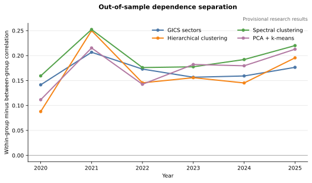
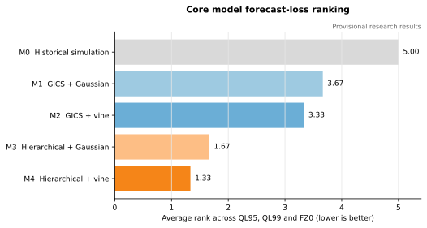
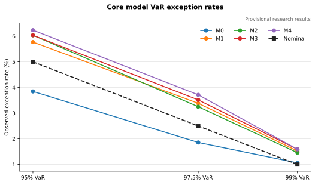

# Do Data-Driven Stock Clusters and Vine Copulas Improve Portfolio Tail-Risk Forecasts?

## Evidence from a Provisional S&P 100 Research Universe

> **Draft status:** Sections 2-9 are drafted from the frozen methodology and
> audited project artifacts. The abstract and Section 1 remain to be
> written. This
> source document deliberately omits personal identifiers; the student's name,
> student ID, recorded workload, and final filename will be inserted only into
> the local submission documents.

## Abstract

*To be drafted after the results, discussion, and conclusion are complete.*

## 1. Introduction

*To be drafted after Sections 3-9 are stable.*

## 2. Literature Review

### 2.1 Dependence-based stock grouping

Industry classifications provide economically interpretable groupings, but
they are not designed to maximise statistical separation in asset returns.
Mantegna (1999) showed that a correlation-derived distance and hierarchical
tree can recover a meaningful economic taxonomy from stock returns. This
established a link between market dependence, network structure, and stock
classification, while also motivating correlation-based grouping as an
alternative to exogenous sectors. For risk modelling, however, a visually or
statistically coherent taxonomy is useful only if it improves the downstream
representation of portfolio dependence out of sample.

Hierarchical clustering supplies nested, deterministic partitions once the
distance and linkage rules are fixed. Spectral clustering offers a nonlinear
alternative: it embeds a similarity graph using eigenvectors before separating
the observations, allowing connected structures that need not be well
represented by ordinary Euclidean clusters (Ng, Jordan and Weiss, 2002).
PCA-plus-k-means takes a different route. PCA forms uncorrelated linear
combinations that preserve as much sample variance as possible in a lower-
dimensional representation (Jolliffe and Cadima, 2016), after which k-means
seeks groups with low within-cluster dispersion (MacQueen, 1967). Spectral and
PCA-based methods therefore encode different notions of structure and should be
treated as competing unsupervised representations rather than interchangeable
versions of the same algorithm.

Cluster validation must also distinguish stability, similarity, and economic
usefulness. The Adjusted Rand Index corrects pairwise partition agreement for
chance (Hubert and Arabie, 1985), while normalised mutual-information measures
quantify shared information between partitions (Vinh, Epps and Bailey, 2010).
Neither establishes superior risk forecasts. A grouping can be stable yet
economically unhelpful, or can separate average correlations without preserving
the tail features relevant to VaR and ES. This motivates evaluating both an
out-of-sample dependence gap and the performance of complete risk models.

### 2.2 Conditional marginal dynamics

Copula analysis does not remove the need to model each marginal return series.
Engle's (1982) ARCH model formalised conditional heteroskedasticity, and
Bollerslev's (1986) GARCH extension provided a parsimonious persistence
mechanism widely suited to financial returns. Conditional Student-t innovations
permit heavier tails than a Gaussian innovation law (Bollerslev, 1987), which
is important when daily equity losses contain more extremes than a conditional
normal model would imply.

Marginal filtering and dependence estimation are sequentially connected. If
conditional means, volatilities, or innovation tails are misspecified, the
transformed series supplied to the copula need not have well-calibrated uniform
margins, and residual serial structure can contaminate the dependence estimate.
The probability-integral-transform principle maps a correctly specified
continuous distribution to uniforms; its multivariate development is associated
with Rosenblatt (1952). In practice, standardised residuals are mapped through
their fitted innovation CDF and checked before dependence is estimated. The
present project consequently holds the marginal protocol fixed across matched
Gaussian and vine comparisons. Otherwise, an apparent copula gain could merely
reflect different volatility filters.

### 2.3 Copulas and regular vines

Sklar's (1959) theorem separates continuous marginal distributions from their
dependence structure. A Gaussian copula is an important benchmark because it is
parsimonious, scalable, and fully described by a correlation matrix. That
parsimony is also restrictive: dependence is symmetric, and non-degenerate
Gaussian copulas have no asymptotic upper or lower tail dependence. A single
elliptical structure may therefore miss pair-specific asymmetry or joint tail
behaviour.

Regular vines build a multivariate copula from conditional bivariate copulas
(Bedford and Cooke, 2002). Pair-copula constructions allow each edge to choose
a different family and parameterisation, making Gaussian, Student-t, Archimedean,
and rotated relationships available within one model (Aas et al., 2009). The
sequential Dißmann et al. (2013) procedure uses maximum-spanning trees based on
absolute Kendall dependence and selects pair families edge by edge. This makes
high-dimensional estimation feasible, but selection is greedy rather than a
global guarantee of the optimal structure.

Flexibility creates a direct complexity problem. An untruncated vine adds
conditional pair copulas through every tree, so parameter counts and estimation
uncertainty rise with dimension. Brechmann, Czado and Aas (2012) developed
truncation and simplification as model-selection responses to this burden.
Financial applications demonstrate that high-dimensional vines can be combined
with GARCH margins for VaR and portfolio analysis (Brechmann and Czado, 2013),
but richer in-sample dependence need not imply lower out-of-sample portfolio
loss. A truncated-versus-full-vine comparison is therefore an essential check
on the bias-variance trade-off.

### 2.4 VaR, Expected Shortfall, and forecast evaluation

VaR is an upper loss quantile and is operationally intuitive, but quantile risk
measures need not be subadditive. The coherent-risk framework of Artzner et al.
(1999) helped motivate Expected Shortfall, which averages losses beyond the VaR
threshold and better reflects tail severity. Evaluation remains subtle because
Expected Shortfall alone is not elicitable by a strictly consistent point-
forecast score. VaR and Expected Shortfall are jointly elicitable, permitting
joint scoring functions under appropriate conditions (Fissler and Ziegel,
2016); the FZ0 form used here follows the dynamic risk-forecasting framework of
Patton, Ziegel and Chen (2019).

Coverage tests and scoring rules answer different questions. Kupiec (1995)
tests whether the exception frequency matches the nominal probability, whereas
Christoffersen (1998) tests whether exceptions are independent through time.
Neither ranks the size of daily forecast errors. Quantile and joint VaR-ES
losses provide that complementary ranking information. Matched loss
differences can be tested using Diebold and Mariano (1995), with Newey-West
(1987) covariance estimation allowing serial dependence in the daily score
sequence.

Testing several models, confidence levels, and scores creates scope for
selective inference. Holm's (1979) step-down method controls the family-wise
error rate for confirmatory families. For a broader exploratory family,
Benjamini and Hochberg (1995) control the expected false-discovery proportion
under their stated conditions and offer greater power than family-wise control.
The distinction matches this project's separation of H1-H3 from its ML and
robustness analyses.

### 2.5 Research gap

The individual building blocks are established; the unresolved question is how
they interact under a controlled forecasting design. A clustering method may
improve dependence separation without improving portfolio tails, and a vine may
fit multivariate innovations better without lowering VaR or ES forecast loss.
This study therefore holds the realised portfolio, marginal models, estimation
windows, simulation draws, scoring rules, and inference procedures constant
while varying grouping and copula dependence. It then extends the same controls
to spectral clustering and PCA-plus-k-means. The contribution is not a new
clustering or copula algorithm, but evidence on whether added representation
and dependence flexibility survive genuinely out-of-sample, multiplicity-
adjusted portfolio-risk evaluation.

## 3. Data and Research Design

### 3.1 Research universe and provenance

The study uses a frozen large-cap US equity research universe intended to
represent the securities in the S&P 100 on 2 January 2020. The membership and
GICS sector labels were fixed before the out-of-sample model comparisons. No
later index additions were introduced. This design avoids changing the research
question in response to subsequent index composition, while annual active sets
allow securities with documented terminal events to leave the portfolio at the
next calendar-year rebalance.

The provenance of the universe requires an explicit qualification. Membership
is based on an archived contemporaneous Wikipedia revision dated 21 November
2019, while Yahoo metadata and price availability on 2 January 2020 provide a
secondary cross-check. These sources do not constitute licensed point-in-time
evidence of index membership, historical GICS classification, or permanent
security identity. Protocol amendment PA-001 permits modelling on this basis,
but the universe gate remains `provisional_authorized_yahoo` and every empirical
result is therefore reported as a provisional research result. The analysis
does not describe Yahoo as an authoritative historical constituent source.

The initial source table contained 101 candidate securities. A security entered
the fixed research universe only if both price and return coverage reached 95%
over the initial period from 3 January 2017 to 31 December 2019. One candidate,
Dow Inc. (DOW), was excluded because the new company's price history begins in
April 2019 and covers only approximately 25.2% of the initial price window. The
legacy Dow Chemical series was not joined to the new Dow Inc. series; doing so
would create an economically invalid return across two different security
lineages. The final modelling universe consequently contains 100 securities
across 11 non-empty GICS sectors. The active set contains 100 securities in
2020 and 98 from the 2021 annual rebalance onward following documented terminal
events. GOOG and GOOGL remain separate listed securities in the primary
analysis. A robustness construction replaces them with one equally weighted
Alphabet issuer position.

### 3.2 Market data and total-return construction

The market-data sample runs from 3 January 2017 through 31 December 2025 and
contains 2,262 expected New York Stock Exchange sessions. The raw inputs are
daily unadjusted open, high, low, close, and volume observations together with
dividend and corporate-action reference records. The use of unadjusted prices
keeps the economic components of total return explicit rather than relying on
an undocumented vendor-adjusted close.

For security \(i\) on date \(t\), the close-to-close simple total return is
constructed from the price change and applicable cash or security
distributions. The corresponding log total return is

\[
\ell_{i,t}=\log(1+r_{i,t}).
\]

Cross-sectional portfolio calculations use simple returns, not averages of log
returns. Log returns are retained for time-series marginal modelling only. This
distinction is important: an arithmetic mean of stock log returns represents a
geometric aggregation and does not equal the simple return on an equal-weight
portfolio.

An independently generated exchange-session grid is combined with explicit
listing and terminal dates. Each absent security-date observation must be
classified as pre-inception, a verified halt, terminal cash, removed, or an
unexplained active-period absence. Unexplained active-period absences fail the
construction gate. Two missing BIIB sessions, 6 November 2020 and 9 June 2023,
were verified as trading halts. Each receives a synthetic stale-price return of
zero, while the cumulative market movement remains in the observed return when
trading resumes. This treatment avoids both deleting an active portfolio
position and spreading the resumption movement over a day when the position
could not trade.

Corporate actions are reconciled to typed economic events rather than treated
as interchangeable vendor split factors. The classifications distinguish
literal splits, stock dividends, spin-offs, merger exchanges, and cash
acquisitions. Spin-offs use documented child-share ratios and values; a provider
continuity factor cannot be applied a second time. Allergan's terminal value is
booked as USD 120.30 in cash plus 0.866 times AbbVie's event-date close. The
primary Walgreens Boots Alliance terminal value on 28 August 2025 is USD 11.45
cash plus a USD 0.53 market-implied value for the non-transferable DAP right.
After terminal consideration is booked, the proceeds earn a zero return until
the next annual rebalance. Endpoint sensitivities value the DAP at zero and at
its contractual USD 3 cap, but do not alter the primary data construction.

Extreme returns are retained only after an observation-level disposition. The
OXY total return of -50.48% on 9 March 2020 was reconciled to the oil-price shock,
raw OHLC observations, and the applicable dividend. The BIIB return of +43.97%
on 4 November 2020 was reconciled to the release of FDA briefing materials.
Both are treated as genuine economic observations and are not winsorised. This
is especially important for a tail-risk study, where mechanically suppressing
large valid returns would bias both marginal tail fitting and dependence
estimation.

The final construction audit reports zero duplicate security-date observations,
zero non-positive closing prices, no unexplained active-period gaps, and no
unmatched or unclassified reference events. All 3,175 dividend and action
records are classified as applied, duplicate-aggregated, or out-of-segment.
These checks support the computational integrity of the return panel but do not
remove the separate point-in-time universe-provenance limitation.

### 3.3 Estimation and evaluation windows

The first three years, 2017-2019, form the initial estimation history. The
out-of-sample evaluation period is 2 January 2020 through 31 December 2025,
comprising 1,508 trading dates. Group definitions are re-estimated on the first
trading day of each year using the left-closed, right-open interval beginning
three calendar years earlier and ending immediately before the rebalance date.
Marginal and copula models are refitted on the first trading day of each month
using information ending on the preceding trading date. Between monthly
refits, marginal parameters remain fixed while conditional mean and volatility
states update daily using only previously observed returns.

This timing convention separates estimation from evaluation at every stage. A
2020 cluster, for example, uses no 2020 return, and a forecast for date (t)
cannot use the realised return or any transformation of information first
observed on (t). Historical simulation uses an analogous three-calendar-year
window, \([t-3\text{ years},t)\), with at least 700 valid observations.

### 3.4 Common portfolio target

Let \(r_{i,t}=\exp(\ell_{i,t})-1\) be the simple total return of security \(i\).
For group \(g\) in calendar year \(y\), the equal-weight group return is

\[
r_{g,t}=\frac{1}{n_{g,y}}\sum_{i\in g_y}r_{i,t},
\]

where \(n_{g,y}\) is the number of active securities in the group. The primary
portfolio is rebalanced to equal security weights every day. Giving each group
the weight \(n_{g,y}/N_y\) yields

\[
R_{p,t}
=\sum_g\frac{n_{g,y}}{N_y}r_{g,t}
=\frac{1}{N_y}\sum_i r_{i,t}.
\]

Thus the GICS and data-driven representations reconstruct the same realised
equal-weight stock portfolio. This identity isolates the effects of grouping
and dependence modelling: M1-M4 cannot obtain a different realised portfolio
merely by assigning the same stocks to different groups. Verified-halt and
terminal-cash positions remain in \(n_{g,y}\) with a zero return until annual
removal. Across 2,261 defined return dates, direct stock-level and group-size-
weighted portfolio returns agree to a maximum error of
\(5.55\times10^{-17}\), well inside the frozen \(10^{-12}\) tolerance.

The realised loss used throughout the evaluation is

\[
L_t=-R_{p,t},
\]

so positive values denote portfolio losses. The secondary equal-group
portfolios are distinct robustness exercises. They reset to equal group weights
annually and drift between annual rebalances, and are never ranked directly
against the primary portfolio because their realised return series differ.

## 4. Methodology

### 4.1 Sector and hierarchical representations

GICS sectors provide the economically interpretable benchmark grouping. The
data-driven alternative is estimated separately for each evaluation year from
the preceding three-calendar-year stock-return window. Spearman rank
correlations are used because the grouping objective concerns monotonic
dependence and should be less sensitive than Pearson correlation to the exact
magnitude of a small number of extreme returns. Each pair must have valid joint
observations on at least 80% of the annual training dates; the procedure fails
rather than silently deleting an ineligible pair.

Following the correlation-distance construction used in financial clustering
(Mantegna, 1999), the annual correlation matrix is transformed as

\[
d_{ij}=\sqrt{\frac{1-\rho_{ij}}{2}}.
\]

This maps perfect positive correlation to zero distance and perfect negative
correlation to one. Average-linkage agglomerative clustering is then applied.
The Lance-Williams update is weighted by cluster size, so every original
cross-cluster security pair receives equal weight. Exact distance ties and the
final cluster labels are resolved by lexicographically ordered member tuples,
making the annual assignment deterministic.

The number of hierarchical clusters equals the number of non-empty GICS
sectors, which is 11 in every evaluation year. Holding dimension constant
prevents the hierarchical method from improving fit mechanically through a
larger number of groups. Annual assignments use only information available
before the rebalance date and remain fixed through that calendar year.

The primary grouping statistic is an out-of-sample within-minus-between
dependence gap. For grouping method \(m\) and evaluation year \(y\),

\[
G_{m,y}=
\overline{\rho}^{\,\mathrm{OOS}}_{\mathrm{within},m,y}
-\overline{\rho}^{\,\mathrm{OOS}}_{\mathrm{between},m,y}.
\]

Every unordered security pair receives equal weight. Singleton groups
contribute no within-group pair and are not inserted as zero-dependence groups;
their cross-group pairs remain in the between-group mean. Reports also retain
pair counts, the number of groups contributing within pairs, consecutive-year
Adjusted Rand Index on intersected active sets, and annual normalised mutual
information relative to GICS.

### 4.2 Marginal return dynamics

Copulas describe dependence after marginal dynamics have been filtered. For
each of the 11 group return series, the modelling input is
\(x_{g,t}=\log(1+r_{g,t})\). The primary marginal model is an
AR(1)-GARCH(1,1) process with Student-t innovations (Engle, 1982; Bollerslev,
1986):

\[
x_{g,t}=\mu_g+\phi_g x_{g,t-1}+\varepsilon_{g,t},
\qquad
\varepsilon_{g,t}=\sigma_{g,t}z_{g,t},
\]

\[
\sigma_{g,t}^{2}=\omega_g
+\alpha_g\varepsilon_{g,t-1}^{2}
+\beta_g\sigma_{g,t-1}^{2}.
\]

The Student-t innovation \(z_{g,t}\) is standardised to unit variance. Returns
are multiplied by 100 during numerical estimation and converted back to decimal
units in stored forecasts. An insignificant AR coefficient is not a reason to
discard the AR term, because model selection based on repeated in-sample
significance testing would make the forecast procedure data dependent in a way
not specified by the protocol.

Each fit must satisfy finite likelihood and information criteria,
\(|\phi|<0.98\), non-negative variance parameters,
\(\alpha+\beta<0.999\), Student-t degrees of freedom above 2.1, and a positive
finite forecast variance. Failure triggers a deterministic sequence: a second
AR-GARCH-t attempt with controlled starting values, a constant-mean GARCH-t
fit, and finally EWMA with decay parameter \(\lambda=0.94\) and empirical
standardised innovations. A monthly EWMA fraction above 1% fails the modelling
quality gate. Numerical fallbacks are therefore observable model outcomes, not
silent exception handling.

For an accepted Student-t model, standardised residuals are mapped through the
fitted unit-variance Student-t distribution. For EWMA, they are mapped through
the frozen training-sample empirical distribution using midranks. Probability
integral transforms (PITs) are clipped to
\([10^{-6},1-10^{-6}]\) to avoid infinite inverse-CDF values. The monthly
copula training panel retains only dates on which all 11 group PITs are
available and strictly precede the refit date.

### 4.3 Gaussian dependence benchmark

By Sklar's theorem, a multivariate distribution can be represented through its
marginal distributions and a copula that contains the remaining dependence.
The Gaussian benchmark transforms each aligned PIT \(u_{g,t}\) to a normal
score \(z_{g,t}=\Phi^{-1}(u_{g,t})\) and estimates the sample Pearson
correlation matrix of those scores.

The estimated matrix is symmetrised before simulation. If its minimum
eigenvalue is below \(10^{-8}\), eigenvalues are floored at \(10^{-8}\), the
matrix is reconstructed, and the diagonal is rescaled to one. Any adjustment
larger than \(10^{-12}\) is reported, and a repaired condition number above
\(10^{10}\) fails the Gaussian quality gate. Cholesky factorisation generates
correlated Gaussian scores, which are transformed to uniforms and then through
the inverse conditional marginal distributions. The Gaussian copula density
also supplies a daily dependence log score, but that score is compared only
with a vine fitted to the same grouping representation.

### 4.4 Regular-vine dependence model

A regular vine decomposes an 11-dimensional copula density into a sequence of
conditional bivariate copulas. This pair-copula construction allows different
pairs to exhibit different forms of symmetry and tail dependence (Aas et al.,
2009). The primary model is truncated after tree 3 to balance flexibility
against the estimation burden of a full ten-tree vine.

Structure selection follows the sequential Dißmann procedure (Dißmann et al.,
2013). Tree 1 is the maximum-spanning tree under absolute empirical Kendall
tau. Subsequent trees obey the vine proximity condition and are selected from
conditional-dependence estimates produced by the preceding trees. For each
edge, sequential maximum likelihood and AIC select among independence,
Gaussian, Student-t, Frank, and the relevant rotations of Clayton and Gumbel
copulas. Copula-t degrees of freedom are restricted to \([2.1,50]\).

Failure of an individual pair fit replaces that pair with independence and is
recorded. If more than 10% of a month's pair fits fail, or the monthly structure
cannot be estimated, the corresponding Gaussian copula supplies that month's
forecasts. If whole-vine fallback covers more than 1% of out-of-sample dates,
the vine is ineligible to be declared the best model. A full ten-tree vine is
estimated separately as an exploratory robustness model using identical
monthly information sets and simulation seeds; it does not overwrite the
primary tree-3 artifacts.

### 4.5 Simulation and daily forecasting

Each monthly copula fit uses 100,000 Monte Carlo scenarios generated by NumPy's
`PCG64DXSM` bit generator from
`SeedSequence([5110, year, month])`. Gaussian and vine specifications use the
same stored independent-uniform matrix within each month. These common random
numbers reduce simulation noise in matched model differences without changing
the distribution implied by either copula.

The simulated uniforms are inverted through each group's conditional marginal
distribution. Student-t innovations are multiplied by
\(\sqrt{(\nu-2)/\nu}\) to impose unit variance; an EWMA marginal uses the
inverted empirical CDF of its complete frozen innovation sample. The resulting
group log returns are converted to simple returns using `expm1` before they are
aggregated with annual group-size weights. This reproduces the same economic
portfolio convention used for realised returns.

Every model supplies one-day-ahead 95%, 97.5%, and 99% VaR forecasts and 97.5%
Expected Shortfall. Parameters and dependence structures remain fixed within a
month, but conditional marginal states are updated each day from information
available through the preceding session.

### 4.6 Core model comparison

The empirical design contains one non-parametric benchmark and four matched
copula specifications:

| Model | Grouping | Margins and dependence |
|---|---|---|
| M0 | None | Rolling historical simulation of the primary portfolio |
| M1 | GICS sectors | AR-GARCH-t margins and Gaussian copula |
| M2 | GICS sectors | AR-GARCH-t margins and tree-3 R-vine |
| M3 | Hierarchical clusters | AR-GARCH-t margins and Gaussian copula |
| M4 | Hierarchical clusters | AR-GARCH-t margins and tree-3 R-vine |

M0 uses the canonical realised daily-rebalanced portfolio series over the
three-calendar-year window. Its VaR is the empirical order statistic at
\(\lceil nc\rceil\) for confidence level \(c\). ES integrates the empirical
quantile function over the upper loss tail and fractionally weights the boundary
observation when \(n(1-c)\) is not an integer. M0 has no grouping, marginal
filter, copula, simulation seed, or copula log score.

The comparisons are intentionally factorial. M2 versus M1 isolates dependence
specification within GICS; M4 versus M3 does the same within hierarchical
clusters. Comparisons across M1/M2 and M3/M4 combine representation and
dependence effects and therefore inform the integrated ranking rather than a
single component claim.

## 5. Forecast Evaluation and Inference

### 5.1 Loss and exception conventions

All forecasts use the positive-loss convention. At confidence level \(c\), the
VaR forecast \(q_{c,t}\) is an upper quantile of \(L_t\), and an exception occurs
when \(L_t>q_{c,t}\). VaR accuracy is evaluated using the quantile loss

\[
Q_c(L_t,q_{c,t})
=\left(c-\mathbf{1}\{L_t<q_{c,t}\}\right)
\left(L_t-q_{c,t}\right).
\]

Lower average loss indicates a more accurate quantile forecast. The core
ranking uses quantile loss at 95% and 99%.

Expected Shortfall cannot be ranked in isolation by a strictly consistent
point-forecast score, but VaR and ES are jointly elicitable under regularity
conditions (Fissler and Ziegel, 2016). At confidence
\(c=0.975\), tail probability \(p=0.025\), VaR \(q_t\), and positive-loss ES
\(e_t\), the project uses the frozen FZ0 score (Patton, Ziegel and Chen, 2019)

\[
S_{FZ0}(L_t,q_t,e_t)=
\frac{\mathbf{1}\{L_t>q_t\}(L_t-q_t)}{p e_t}
+\frac{q_t}{e_t}+\log(e_t)-1,
\]

subject to \(e_t\ge q_t\) and \(e_t>0\). Lower mean FZ0 is better. The three
primary losses are therefore 95% quantile loss, 99% quantile loss, and 97.5%
FZ0.

### 5.2 VaR calibration

The Kupiec test evaluates whether the full-period exception frequency equals
the nominal tail probability (Kupiec, 1995). Frequency alone does not detect
clusters of exceptions, so the Christoffersen test evaluates first-order
independence in the binary exception sequence (Christoffersen, 1998). The
conditional-coverage statistic is reported as an unadjusted descriptive
companion rather than an additional confirmatory test.

The confirmatory calibration family contains 20 tests: five models, two primary
VaR levels (95% and 99%), and the Kupiec and Christoffersen-independence tests.
Holm's step-down procedure controls family-wise error at 5% (Holm, 1979).
Annual coverage
results at 95%, 97.5%, and 99% are descriptive only. With 1,508 evaluation
dates, the expected number of 99% exceptions is approximately 15; subdividing
that count by year produces tests with little power. Forecast losses and
full-period matched comparisons consequently carry more evidential weight.

### 5.3 Matched predictive-accuracy tests

For a given grouping and score (S), the daily loss differential is

\[
d_t=S_{\mathrm{vine},t}-S_{\mathrm{Gaussian},t}.
\]

A negative mean favours the vine. The Diebold-Mariano test evaluates equal
predictive accuracy using a two-sided alternative (Diebold and Mariano, 1995).
Because daily loss differentials may be serially correlated, the variance of
their sample mean uses the Newey-West estimator with Bartlett weights and lag
7 (Newey and West, 1987). Direction is examined only after the two-sided result
has been evaluated.

The H2 family contains six comparisons: M2 versus M1 and M4 versus M3 for each
of the three primary losses. Holm adjustment controls family-wise error at 5%.
Copula log scores are descriptive and are compared only within a matched
grouping because GICS and hierarchical models have different multivariate group
return representations.

### 5.4 Clustering inference

H1 concerns the annual difference

\[
\Delta_y=G_{\mathrm{hierarchical},y}-G_{\mathrm{GICS},y}.
\]

The point estimate is the equally weighted mean of the six annual differences.
Uncertainty is estimated with 10,000 paired circular moving-block bootstrap
replications using blocks of 20 trading days. Entire daily cross-sectional
return vectors are resampled so that contemporaneous dependence is preserved.
Blocks wrap within an evaluation year but never cross year boundaries, and the
same resampled indices are applied to both grouping methods. If a resample
makes a retained security constant and produces undefined Spearman
correlations, the whole paired replication is discarded and the deterministic
`PCG64DXSM` stream continues. H1 requires both a positive point estimate and a
strictly positive two-sided 95% percentile interval.

### 5.5 Prespecified decisions and integrated ranking

H2 receives full support only if all six Holm-adjusted matched comparisons are
significant and have lower vine loss. It receives partial support if at least
one adjusted comparison favours the vine and none favours the Gaussian model;
all other patterns are classified as no support. This demanding rule prevents
selective emphasis on one confidence level or scoring function.

The overall model ranking gives equal weight to each model's rank on the three
primary mean losses. H3 is supported only if M4 is uniquely first, passes the
vine-quality gate, and has no Holm-adjusted Kupiec or Christoffersen-
independence rejection at either primary VaR level. Any such adjusted rejection
is the operational definition of systematic calibration failure.

H2 and H3 answer different questions. H2 tests whether vines consistently
improve matched forecast loss after multiplicity adjustment. H3 asks whether
the complete hierarchical-vine specification is the best eligible model under
the prespecified combined ranking and calibration rule. A favourable H3 result
cannot be used to retroactively declare H1 or H2 supported.

## 6. Core Empirical Results

This section reports the prespecified H1-H3 tests over the 1,508 out-of-sample
dates. All findings retain the provisional-universe qualification described in
Section 3. The distinction between three questions is important: H1 tests the
information in the grouping, H2 tests vine versus Gaussian dependence within a
matched grouping, and H3 ranks the five complete forecasting systems.

### 6.1 Dependence separation and H1

The annual dependence gaps do not show a persistent advantage for hierarchical
clustering. Hierarchical groups have the larger gap in 2021 and 2025, whereas
GICS has the larger gap in 2020, 2022, 2023, and 2024. The largest annual
difference is negative in 2020, when the hierarchical gap is 0.0879 compared
with 0.1414 for GICS. The strongest hierarchical result occurs in 2021, when
its gap exceeds the GICS gap by 0.0434. The near-zero difference in 2023
indicates that the two representations can also produce almost indistinguishable
separation despite assigning stocks differently.

| Year | GICS gap | Hierarchical gap | Hierarchical minus GICS |
|---:|---:|---:|---:|
| 2020 | 0.1414 | 0.0879 | -0.0535 |
| 2021 | 0.2067 | 0.2501 | 0.0434 |
| 2022 | 0.1729 | 0.1454 | -0.0275 |
| 2023 | 0.1566 | 0.1557 | -0.0009 |
| 2024 | 0.1592 | 0.1452 | -0.0140 |
| 2025 | 0.1765 | 0.1955 | 0.0190 |
| **Equal-year mean** | **0.1689** | **0.1633** | **-0.0056** |

*Figure 1. Annual within-minus-between Spearman dependence gaps. H1 uses only
the GICS and hierarchical series; the exploratory spectral and PCA-plus-k-means
series are discussed in Section 7.*

The equally weighted mean hierarchical-minus-GICS difference is -0.005590.
Its paired circular moving-block bootstrap 95% interval is
[-0.018669, 0.006569]. The estimate therefore has the wrong sign for H1, and
the interval includes zero. H1 is not supported under its frozen requirement
of a positive point estimate and a strictly positive interval.

This decision does not imply that hierarchical clustering contains no useful
structure. The annual hierarchical assignments have moderate overlap with GICS
(normalised mutual information ranges from 0.508 to 0.686) and their
consecutive-year stability varies materially (Adjusted Rand Index ranges from
0.346 to 0.792 where defined). The narrower conclusion is that the selected
rolling-window algorithm did not establish superior *out-of-sample dependence
separation* relative to the sector benchmark in this sample.

### 6.2 Forecast-loss ranking

All four filtered copula models have lower mean loss than historical simulation
on each primary score. M0 ranks fifth on 95% quantile loss, 99% quantile loss,
and the joint 97.5% FZ0 score. This descriptive gap is consistent with the value
of updating conditional volatility and cross-sectional dependence, although the
confirmatory DM family was designed for matched vine-Gaussian comparisons and
does not provide a formal M0-versus-copula significance test.

| Overall rank | Model | Mean QL 95% | Mean QL 99% | Mean FZ0 97.5% | Average score rank |
|---:|---|---:|---:|---:|---:|
| 1 | M4: hierarchical + vine | 0.001272 | 0.000385 | -3.6164 | 1.333 |
| 2 | M3: hierarchical + Gaussian | 0.001266 | 0.000388 | -3.6122 | 1.667 |
| 3 | M2: GICS + vine | 0.001284 | 0.000405 | -3.5965 | 3.333 |
| 4 | M1: GICS + Gaussian | 0.001276 | 0.000407 | -3.5948 | 3.667 |
| 5 | M0: historical simulation | 0.001527 | 0.000584 | -3.1931 | 5.000 |

*Figure 2. Average rank across 95% quantile loss, 99% quantile loss, and 97.5%
FZ0. Lower values indicate better average forecast performance.*

M4 is uniquely first with an average rank of 1.333. It ranks first on 99%
quantile loss and FZ0, but second to M3 on 95% quantile loss. M3 is correspondingly
first on the 95% score and second on the other two. The ranking therefore does
not show uniform M4 dominance. Instead, it shows a small trade-off: the
hierarchical Gaussian model performs best at the less extreme VaR level, while
the hierarchical vine performs best on the two more tail-focused primary
scores. Both hierarchical models outrank both GICS models on the aggregate
criterion, even though H1 itself is not supported. A grouping can thus be useful
inside a nonlinear forecasting system without satisfying a separate
within-minus-between correlation hypothesis.

### 6.3 Matched vine-Gaussian comparisons and H2

The signs of the matched loss differences are consistent across the two
groupings but mixed across scoring rules. The vines have lower mean loss for
99% VaR and joint 97.5% VaR-ES, while the Gaussian copulas have lower mean loss
for 95% VaR. None of the six two-sided DM tests is significant after Holm
adjustment.

| Grouping | Score | Vine minus Gaussian mean loss | Holm-adjusted p-value | Descriptive direction |
|---|---|---:|---:|---|
| GICS | QL 95% | 0.00000792 | 0.587 | Gaussian |
| GICS | QL 99% | -0.00000176 | 0.808 | Vine |
| GICS | FZ0 97.5% | -0.001667 | 0.808 | Vine |
| Hierarchical | QL 95% | 0.00000530 | 0.443 | Gaussian |
| Hierarchical | QL 99% | -0.00000317 | 0.446 | Vine |
| Hierarchical | FZ0 97.5% | -0.004143 | 0.704 | Vine |

The smallest unadjusted p-value is 0.0738 for hierarchical 95% quantile loss;
even that comparison points towards the Gaussian model and does not meet the
unadjusted 5% threshold. The confirmatory result is therefore not an artefact of
Holm correction alone. With zero of six adjusted comparisons favouring the
vine, H2 has no support. Descriptive copula log scores and M4's overall rank do
not override this decision because they answer different questions.

### 6.4 Calibration and H3

Exception frequencies alone do not determine calibration. M0 records 58
exceptions at 95% and 16 at 99%, compared with expectations of 75.4 and 15.08.
Although neither adjusted Kupiec test rejects frequency calibration, the
Christoffersen independence test rejects at both primary levels after Holm
adjustment (adjusted p-values 0.00084 and 0.00713). Its exceptions are therefore
too clustered under the prespecified rule, and M0 is classified as a systematic
calibration failure.

*Figure 3. Full-period exception rates at the reported VaR confidence levels.
Dashed reference levels indicate nominal exception probabilities.*

M1-M4 record 87-94 exceptions at 95% and 22-24 at 99%. None has a Holm-adjusted
Kupiec or independence rejection at either primary level. This is not a claim
that their observed rates equal the nominal rates exactly. For example, M4 has
94 rather than 75.4 expected 95% exceptions and 24 rather than 15.08 expected
99% exceptions. It means that the deviations do not cross the prespecified
family-wise-adjusted rejection threshold in a sample of 1,508 dates.

M4 satisfies all three parts of the H3 rule: it is uniquely first on average
primary-score rank, the vine-quality audit declares it eligible with no
whole-vine fallback dates, and it has no adjusted primary calibration rejection.
H3 is consequently supported. This is an integrated, within-experiment model
selection result. It does not establish that vines generally dominate Gaussian
copulas: the direct H2 comparisons provide no such evidence, and M4's ranking
advantage is not uniform across scores.

### 6.5 Hypothesis summary

| Hypothesis | Frozen question | Decision | Decisive evidence |
|---|---|---|---|
| H1 | Do hierarchical clusters separate dependence better than GICS? | **Not supported** | Mean difference -0.005590; 95% interval [-0.018669, 0.006569] |
| H2 | Do vines improve matched loss over Gaussian copulas? | **No support** | 0 of 6 Holm-adjusted DM tests favour the vine |
| H3 | Is M4 the best eligible integrated core model? | **Supported** | Unique average-rank winner (1.333), vine-quality eligible, no systematic calibration failure |

Taken together, the core results favour restraint. Neither data-driven
hierarchical grouping nor flexible vine dependence wins its isolated
confirmatory test. Nevertheless, their combination produces the strongest
prespecified integrated ranking without breaching the model-quality or
calibration gates. The subsequent robustness analysis asks whether that narrow
conclusion survives alternative unsupervised groupings, vine depth, portfolio
weights, historical-simulation construction, and WBA terminal valuation.

## 7. ML Extension and Robustness

The analyses in this section were designated exploratory before their risk
results were inspected. They extend the core design without revising the
confirmatory H1-H3 decisions. Where the realised portfolio changes, models are
ranked only within that portfolio target.

### 7.1 Spectral clustering and PCA-plus-k-means

The substantial ML extension replaces the hierarchical assignments with two
additional unsupervised representations. Spectral clustering applies an RBF
affinity to the Spearman correlation-distance matrix, while PCA-plus-k-means
clusters stocks in a lower-dimensional principal-component embedding. Both
methods use the same rolling three-calendar-year information sets, annual
rebalance dates, 11-group constraint, daily portfolio arithmetic, and seeded
initialisation protocol as the core analysis. Every annual solution contains
11 non-empty groups and reconstructs the primary stock portfolio within
\(6.94\times10^{-17}\).

Spectral clustering has the strongest descriptive dependence separation. Its
six-year mean gap exceeds GICS by 0.02734 and hierarchical clustering by
0.03293. The corresponding PCA-plus-k-means differences are smaller but still
positive on average, at 0.00510 and 0.01069. This result strengthens the case
that nonlinear graph-based clustering can identify compact correlation
communities. It does not, by itself, show that those communities improve tail-
risk forecasts.

| Model | Representation and dependence | QL 95% | QL 99% | FZ0 97.5% |
|---|---|---:|---:|---:|
| M5 | Spectral + Gaussian | 0.001280 | 0.000416 | -3.5898 |
| M6 | Spectral + vine | 0.001281 | 0.000405 | -3.6001 |
| M7 | PCA-k-means + Gaussian | 0.001275 | 0.000406 | -3.5934 |
| M8 | PCA-k-means + vine | 0.001279 | 0.000395 | -3.6042 |

The ML models reproduce the core dependence pattern: vines have lower 99%
quantile loss and FZ0 within both representations, whereas Gaussian copulas
have lower 95% quantile loss. The broader evaluation compares M5-M8 with their
matched GICS and hierarchical baselines across 24 loss differentials. After
Benjamini-Hochberg control at a 5% false-discovery rate, no comparison favours
an ML grouping and none favours a baseline grouping. Stronger descriptive
clustering separation therefore does not translate into statistically
detectable VaR/ES forecast improvement in this sample.

### 7.2 Vine depth

The primary vine stops after tree 3; the robustness specification estimates all
ten possible trees. The mean number of fitted parameters rises from 40.51 to
66.22 per monthly refit, an increase of 25.71 parameters. The full vine has a
higher descriptive copula log score within both groupings: the mean improvement
is 0.0440 for GICS and 0.1367 for hierarchical clusters. This is evidence of
better fit to the multivariate PIT sample, not necessarily better portfolio-
loss forecasts.

Five of the six mean forecast-loss differences favour the full vine, while the
hierarchical 99% quantile loss favours tree 3. None is significant after Holm
adjustment. Both depths complete all 144 refits without whole-vine fallback.
The robustness exercise therefore supplies no adjusted forecast-loss evidence
that the additional trees justify their estimation complexity; the tree-3
results remain the primary results.

### 7.3 Equal-group portfolio weighting

The primary portfolio gives every security the same daily weight. The weighting
robustness instead assigns equal weights to the 11 groups at each annual
rebalance and lets those group weights drift. This creates different realised
GICS-balanced and hierarchical-balanced portfolios, so their losses cannot be
ranked against each other or against M0-M4 as though the target were unchanged.

Within each balanced portfolio, the Gaussian model ranks first with an average
primary-score rank of 1.333, and the vine ranks second at 1.667. Historical
simulation ranks third. No Holm-adjusted matched loss comparison favours either
the vine or Gaussian specification. The reversal from M4's primary integrated
rank shows that portfolio construction and dependence modelling interact, but
the absence of adjusted pairwise evidence remains consistent with H2.

### 7.4 Historical-simulation constituent history

M0 uses the realised annual active sets in its rolling history. The alternative
M0_CC freezes each forecast year's active set throughout that forecast's
three-year training window. This changes at least one forecast on 710 of 1,508
dates, although both constructions produce exactly the same exception counts:
58, 28, and 16 at the 95%, 97.5%, and 99% levels.

The realised-history M0 has lower mean loss on all three primary scores. Only
the 99% quantile-loss difference is significant after the separate three-test
Holm correction (adjusted \(p=3.86\times10^{-25}\)); the 95% and FZ0
comparisons are not significant. This sensitivity shows that historical-
simulation tail estimates can depend on how past constituent histories are
constructed. It does not revise H1-H3 because both variants forecast the same
realised primary portfolio and M0 remains outside the matched H2 comparisons.

### 7.5 WBA DAP valuation

The primary WBA terminal value assigns USD 0.53 to the DAP right, making total
consideration equal to the previous USD 11.98 close. The endpoint scenarios
assign the right either zero or its USD 3 contractual cap. They change only the
WBA return on 28 August 2025: the zero-value endpoint implies a -4.42% stock
return, while the cap implies +20.62%. At the 98-security portfolio level these
become approximately -0.089% and +0.167%, respectively.

Both endpoints leave every model's exception counts unchanged. H2 remains
unsupported, H3 remains supported, and the exploratory ML family still has no
FDR-adjusted loss difference. These are deterministic endpoint sensitivities,
not a probabilistic valuation model for the non-transferable right. Their role
is to demonstrate that the core conclusions do not depend on the frozen USD
0.53 assumption.

### 7.6 Robustness synthesis

| Analysis | Main result | Revises H1-H3? |
|---|---|---|
| Spectral and PCA-k-means groupings | 0 of 24 FDR-adjusted loss tests favour either side | No |
| Full tree-10 vine | Better descriptive log score; 0 of 6 adjusted loss tests significant | No |
| Equal-group portfolios | Gaussian ranks first within both targets; no adjusted matched difference | No |
| Current-composition historical simulation | Realised history wins only the adjusted 99% score | No |
| WBA DAP endpoints | Exception counts and frozen decisions unchanged | No |

The common message is that representation, copula flexibility, and portfolio
construction can move descriptive scores without producing stable adjusted
forecast-loss differences. The robustness results consequently reinforce the
narrow interpretation of Section 6: M4 is the best eligible model under the
prespecified integrated ranking, but the evidence does not support a general
claim that more flexible clustering or dependence models must forecast tail
risk better.

## 8. Discussion, Limitations, and Extensions

### 8.1 Interpretation

The results distinguish three objectives that can easily be conflated:
separating stock correlations into groups, fitting the joint distribution of
group innovations, and forecasting portfolio tail loss. A method can improve
one objective without improving the next. Spectral clustering illustrates this
point most clearly. It produces the largest average within-minus-between
dependence gap, yet its downstream VaR and ES losses do not improve
significantly after false-discovery-rate control. The correlation-gap objective
is therefore not a sufficient proxy for tail-risk forecast performance.

The core hierarchical models nevertheless occupy the first two integrated
ranking positions even though H1 is not supported. This is not contradictory.
H1 reduces grouping quality to the mean separation of pairwise Spearman
correlations, whereas the risk pipeline operates on group return distributions,
conditional volatility, and their joint tail behaviour. A representation may
interact productively with these later stages without achieving a larger
average pairwise gap. The evidence supports that possibility within this
experiment, but does not identify hierarchical clustering as the cause of the
ranking outcome.

The vine results show a similar distinction. Relative to matched Gaussian
copulas, the tree-3 vines have descriptively lower loss at 99% VaR and on the
joint VaR-ES score, but higher loss at 95% VaR. None of those differences is
significant after family-wise correction. Greater dependence flexibility may
capture heterogeneous and asymmetric pair relationships, but it also raises
estimation variance in rolling samples of roughly three years. Extending the
vine from tree 3 to tree 10 adds an average of 25.71 fitted parameters and
improves in-sample copula log scores, without delivering an adjusted forecast-
loss gain. This pattern is consistent with a bias-variance trade-off and
supports truncation as a defensible regularisation choice.

M4's H3 support must consequently be read as an operational selection result,
not as proof of either H1 or H2. M4 is uniquely first under an equally weighted
rank of three prespecified losses, passes the vine-quality gate, and has no
adjusted primary calibration rejection. Its lead over M3 is nonetheless
score-dependent: M3 has the lower 95% quantile loss, and their matched loss
differences are not statistically decisive. The main practical conclusion is
that M4 is the preferred candidate among the five systems tested, subject to
continued challenger monitoring rather than automatic production adoption.

### 8.2 Design strengths

The experiment has several safeguards that make this restrained conclusion
credible. Annual grouping and monthly model fits use strictly prior data, while
daily conditional states update without look-ahead. GICS and data-driven
representations reconstruct exactly the same primary realised portfolio, so
their results are not confounded by different stock exposures. Gaussian and
vine models share marginal filters, information sets, portfolio arithmetic,
and common random numbers. Their comparisons therefore isolate the dependence
specification more cleanly than an unrestricted model tournament would.

The implementation also makes numerical failure observable. Marginal models
follow a deterministic fallback chain, only four of 1,584 core fits use EWMA,
and all 144 primary vine refits complete without failed pairs or whole-vine
fallback. Calibration and predictive-accuracy families use prespecified
multiplicity controls. Finally, hashed manifests, fail-closed gates, seeded
simulation and bootstrap streams, and executable artifact tests connect the
reported values to reproducible outputs. These controls are an important part
of the contribution because flexible models are only useful when their data
lineage and failure modes can be audited.

### 8.3 Limitations

The most important limitation is provenance. The intended 2 January 2020 S&P
100 universe and GICS labels are supported by an archived Wikipedia revision
and Yahoo-based cross-checks, not a licensed point-in-time constituent and
classification extract. The protocol authorises this provisional foundation,
but it cannot establish official membership, historical classifications, or
permanent identifiers to institutional-data standards. Every empirical claim
therefore remains provisional.

The universe design introduces additional selection concerns. Constituents are
fixed near the start of evaluation and must pass a 2017-2019 coverage screen.
Explicit acquisitions, terminal cash positions, and annual active sets reduce
ordinary survivorship errors, but the design may still favour securities with
continuous pre-sample histories and does not represent subsequent index
entrants. It answers a fixed-cohort forecasting question rather than measuring
the performance of a continuously reconstituted official index.

Statistical power is limited in the far tail. The 1,508 evaluation dates imply
only 15.08 expected 99% exceptions, making annual tail tests particularly weak.
Multiplicity correction appropriately protects against selective findings but
further reduces power to detect modest effects. H3's rank rule also discards the
magnitude of score differences: a narrow first place receives the same ordinal
credit as a wide one. Loss levels, matched tests, and ranks must therefore be
read together.

Dimension reduction from roughly 100 securities to 11 group returns makes
monthly vine estimation feasible, but may average away firm-specific tail
events and security-level contagion. Dependence parameters remain fixed within
each month, and cluster assignments within each year, so abrupt regime changes
are captured only through daily marginal-state updates until the next scheduled
refit. No explicit regime-switching or time-varying copula is estimated.

The economic target is also stylised. The primary portfolio is equal weighted
and rebalanced daily without transaction costs, market impact, borrowing
constraints, taxes, or liquidity limits. Equal-group robustness changes the
target and cannot establish investable superiority. The analysis forecasts
one-day statistical loss rather than trading returns or regulatory and
economic capital. Finally, the WBA exercise brackets the DAP at deterministic
endpoints; it does not model the right's contingent payoff distribution.
Evidence from one provisional US large-cap cohort should not be extrapolated to
other periods, markets, asset classes, or portfolio mandates.

### 8.4 Prioritised extensions

The first extension should replace the provisional universe with a licensed
point-in-time constituent and GICS extract, retaining permanent security and
issuer identifiers. A continuously reconstituted index variant could then be
run beside the fixed-cohort design to quantify membership-selection effects.
The second priority is external validation across another US index and at least
one international market, using the same frozen scoring and inference rules.

Methodological extensions should address specific limitations rather than add
complexity for its own sake. A separately frozen regime-dependent or smoothly
time-varying copula could test whether monthly dependence updates are too slow.
Sparse higher-dimensional vines or factor-copula hybrids could preserve more
security-level tail information while controlling parameter growth. Portfolio
extensions should compare realistic weekly or monthly rebalancing after
turnover and transaction costs. Finally, multi-day horizons, stress scenarios,
and economic-capital applications would test whether the ranking is relevant
beyond one-day VaR and ES. Each extension should retain the present project's
matched design, leakage controls, multiplicity correction, and reproducible
audit trail.

## 9. Conclusion

This study asks whether data-driven stock grouping and flexible vine-copula
dependence improve one-day portfolio tail-risk forecasts relative to GICS
sectors, Gaussian dependence, and historical simulation. The controlled design
holds the realised daily equal-weight stock portfolio, marginal-model protocol,
information windows, and Monte Carlo draws constant wherever the comparison
requires them to be constant.

The evidence is mixed and does not support universal model superiority.
Hierarchical clusters do not separate out-of-sample dependence better than GICS
under the prespecified H1 test: the mean gap difference is -0.005590 and its 95%
block-bootstrap interval, [-0.018669, 0.006569], includes zero. Vines likewise
do not significantly improve matched forecast loss over Gaussian copulas. Zero
of the six Holm-adjusted DM comparisons favours the vine, so H2 receives no
support.

The complete hierarchical-vine system nevertheless ranks first across the five
core models. M4 has an average primary-score rank of 1.333, passes the vine-
quality gate, and has no adjusted systematic calibration failure; it therefore
satisfies the frozen H3 rule. This finding is narrower than vine dominance. M4
does not have the lowest loss on every score, and its matched differences from
the hierarchical Gaussian model are not statistically decisive. Spectral
clustering, PCA-plus-k-means, full-depth vines, alternative portfolio weights,
historical-constituent treatment, and WBA valuation endpoints do not overturn
the core conclusions.

All empirical results remain provisional because the intended 2 January 2020
S&P 100 universe and GICS labels are not corroborated by a licensed point-in-
time source. Subject to that limitation, the project’s main result is
methodological: an integrated sophisticated model can rank well even when
neither of its individual components demonstrates consistent standalone
superiority. For portfolio-risk research, disciplined experimental control,
loss-based evaluation, multiplicity correction, and reproducible data lineage
are therefore as important as additional model flexibility.

## Working References

The final bibliography style remains to be selected. These entries are the
verified working sources cited in the current draft.

- Aas, K., Czado, C., Frigessi, A. and Bakken, H. (2009). Pair-copula
  constructions of multiple dependence. *Insurance: Mathematics and
  Economics*, 44(2), 182-198.
  <https://doi.org/10.1016/j.insmatheco.2007.02.001>
- Artzner, P., Delbaen, F., Eber, J.-M. and Heath, D. (1999). Coherent
  measures of risk. *Mathematical Finance*, 9(3), 203-228.
  <https://doi.org/10.1111/1467-9965.00068>
- Bedford, T. and Cooke, R.M. (2002). Vines: A new graphical model for
  dependent random variables. *The Annals of Statistics*, 30(4), 1031-1068.
  <https://doi.org/10.1214/aos/1031689016>
- Benjamini, Y. and Hochberg, Y. (1995). Controlling the false discovery rate:
  A practical and powerful approach to multiple testing. *Journal of the Royal
  Statistical Society: Series B*, 57(1), 289-300.
  <https://doi.org/10.1111/j.2517-6161.1995.tb02031.x>
- Bollerslev, T. (1986). Generalized autoregressive conditional
  heteroskedasticity. *Journal of Econometrics*, 31(3), 307-327.
  <https://doi.org/10.1016/0304-4076(86)90063-1>
- Bollerslev, T. (1987). A conditionally heteroskedastic time series model for
  speculative prices and rates of return. *The Review of Economics and
  Statistics*, 69(3), 542-547.
  <https://doi.org/10.2307/1925546>
- Brechmann, E.C., Czado, C. and Aas, K. (2012). Truncated regular vines in
  high dimensions with application to financial data. *Canadian Journal of
  Statistics*, 40(1), 68-85.
  <https://doi.org/10.1002/cjs.10141>
- Brechmann, E.C. and Czado, C. (2013). Risk management with high-dimensional
  vine copulas: An analysis of the Euro Stoxx 50. *Statistics and Risk
  Modeling*, 30(4), 307-342.
  <https://doi.org/10.1524/strm.2013.2002>
- Christoffersen, P.F. (1998). Evaluating interval forecasts.
  *International Economic Review*, 39(4), 841-862.
  <https://doi.org/10.2307/2527341>
- Diebold, F.X. and Mariano, R.S. (1995). Comparing predictive accuracy.
  *Journal of Business & Economic Statistics*, 13(3), 253-263.
  <https://doi.org/10.1080/07350015.1995.10524599>
- Dißmann, J., Brechmann, E.C., Czado, C. and Kurowicka, D. (2013). Selecting
  and estimating regular vine copulae and application to financial returns.
  *Computational Statistics & Data Analysis*, 59, 52-69.
  <https://doi.org/10.1016/j.csda.2012.08.010>
- Engle, R.F. (1982). Autoregressive conditional heteroscedasticity with
  estimates of the variance of United Kingdom inflation. *Econometrica*,
  50(4), 987-1007.
  <https://doi.org/10.2307/1912773>
- Fissler, T. and Ziegel, J.F. (2016). Higher order elicitability and Osband's
  principle. *The Annals of Statistics*, 44(4), 1680-1707.
  <https://doi.org/10.1214/16-AOS1439>
- Holm, S. (1979). A simple sequentially rejective multiple test procedure.
  *Scandinavian Journal of Statistics*, 6(2), 65-70.
  <https://doi.org/10.2307/4615733>
- Hubert, L. and Arabie, P. (1985). Comparing partitions. *Journal of
  Classification*, 2, 193-218.
  <https://doi.org/10.1007/BF01908075>
- Jolliffe, I.T. and Cadima, J. (2016). Principal component analysis: A review
  and recent developments. *Philosophical Transactions of the Royal Society
  A*, 374(2065), 20150202.
  <https://doi.org/10.1098/rsta.2015.0202>
- Kupiec, P.H. (1995). Techniques for verifying the accuracy of risk
  measurement models. *The Journal of Derivatives*, 3(2), 73-84.
  <https://doi.org/10.3905/jod.1995.407942>
- MacQueen, J. (1967). Some methods for classification and analysis of
  multivariate observations. *Proceedings of the Fifth Berkeley Symposium on
  Mathematical Statistics and Probability*, 1, 281-297.
  <https://digicoll.lib.berkeley.edu/record/113015>
- Mantegna, R.N. (1999). Hierarchical structure in financial markets.
  *The European Physical Journal B*, 11, 193-197.
  <https://doi.org/10.1007/s100510050929>
- Newey, W.K. and West, K.D. (1987). A simple, positive semi-definite,
  heteroskedasticity and autocorrelation consistent covariance matrix.
  *Econometrica*, 55(3), 703-708.
  <https://doi.org/10.2307/1913610>
- Ng, A.Y., Jordan, M.I. and Weiss, Y. (2002). On spectral clustering: Analysis
  and an algorithm. *Advances in Neural Information Processing Systems 14*,
  849-856.
  <https://ai.stanford.edu/~ang/papers/nips01-spectral.pdf>
- Patton, A.J., Ziegel, J.F. and Chen, R. (2019). Dynamic semiparametric models
  for expected shortfall (and Value-at-Risk). *Journal of Econometrics*,
  211(2), 388-413.
  <https://doi.org/10.1016/j.jeconom.2018.10.008>
- Rosenblatt, M. (1952). Remarks on a multivariate transformation. *The Annals
  of Mathematical Statistics*, 23(3), 470-472.
  <https://doi.org/10.1214/aoms/1177729394>
- Sklar, A. (1959). Fonctions de répartition à n dimensions et leurs marges.
  *Publications de l'Institut de Statistique de l'Université de Paris*, 8,
  229-231.
- Vinh, N.X., Epps, J. and Bailey, J. (2010). Information theoretic measures
  for clusterings comparison: Variants, properties, normalization and
  correction for chance. *Journal of Machine Learning Research*, 11,
  2837-2854.
  <https://www.jmlr.org/papers/v11/vinh10a.html>
